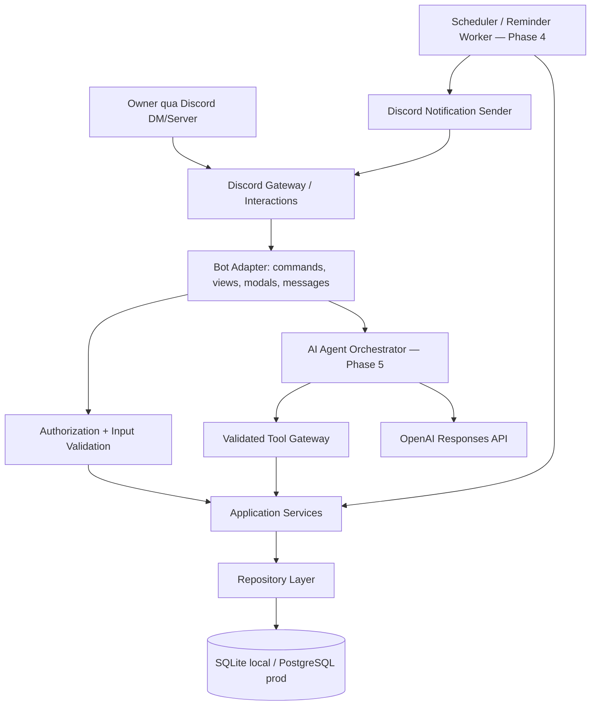
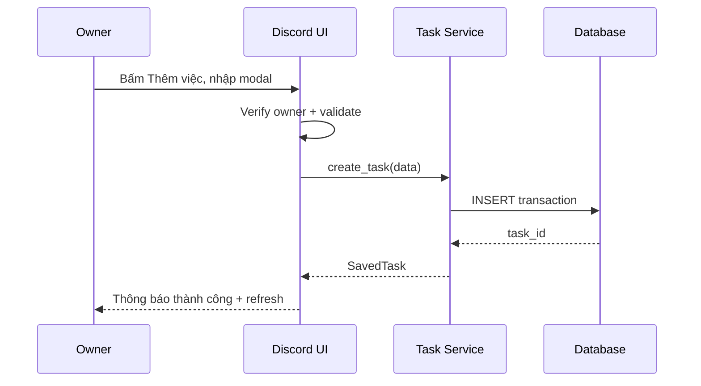
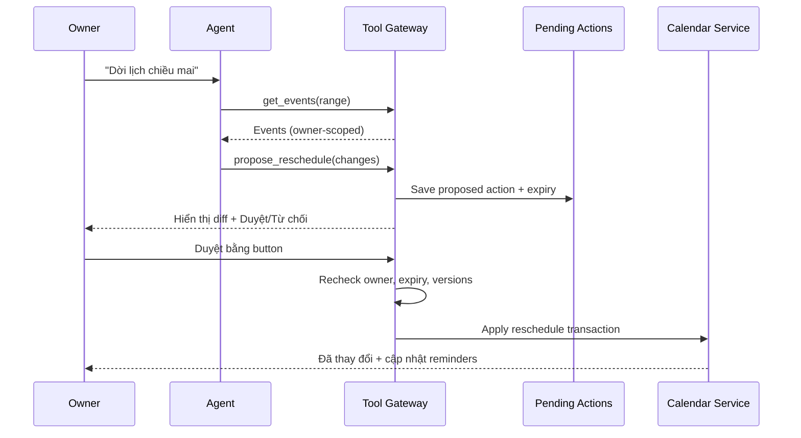

# Architecture — NOVA AI

**Architecture decision:** *Modular monolith*, một process bot + một SQLite DB trong local dev. Dùng service layer thống nhất, để sau này chuyển DB/worker/deployment mà không đổi UX. Không xây web server khi chưa cần OAuth/callback.

## 1. System context



**Giải thích:** Discord gọi handlers; handler xác thực chủ tài khoản rồi chuyển yêu cầu tới service. AI không trực tiếp thao tác database, mà gọi tool gateway. Scheduler lấy reminder đến hạn từ database và gửi thông báo. UI chỉ hiển thị dữ liệu service trả về.

## 2. Cấu trúc source code *dự kiến cho Phase 1 trở đi*

```text
app/
├── main.py                      # start bot + app lifecycle
├── config.py                    # pydantic/env config, no secret logs
├── discord_bot/
│   ├── client.py                # bot instance/intents
│   ├── commands/                # slash commands
│   ├── views/                   # persistent dashboard, modal, select
│   ├── renderers/               # render embeds/views from ViewModels
│   ├── checks.py                # owner guard
│   └── error_handlers.py
├── domain/
│   ├── enums.py                 # statuses, priorities
│   └── schemas.py               # domain DTOs/value objects
├── services/
│   ├── task_service.py
│   ├── project_service.py
│   ├── calendar_service.py
│   ├── reminder_service.py
│   ├── settings_service.py
│   └── dashboard_service.py
├── db/
│   ├── base.py
│   ├── models.py
│   ├── session.py
│   └── repositories/
├── scheduler/                   # Phase 4
│   ├── jobs.py
│   └── dispatcher.py
├── agent/                       # Phase 5
│   ├── orchestrator.py
│   ├── tool_registry.py
│   ├── policy.py
│   └── prompts/
├── automation/                  # Phase 6
│   └── daily_briefing.py
└── integrations/                # Phase 7+
    └── README.md

tests/
alembic/
docs/
AGENTS.md
README.md
.env.example
.gitignore
```

## 3. Kỹ thuật theo phase

| Thành phần | P1–P2 | P3–P4 | P5–P6 | P7+ |
|---|---|---|---|---|
| Bot | `discord.py` Gateway + app commands | views/modals nghiệp vụ | DM message handler | same |
| Database | SQLite `aiosqlite` + SQLAlchemy | Alembic migrations | memory/conversations | PostgreSQL prod |
| AI | chưa tích hợp | chưa yêu cầu | OpenAI Responses API, function calling | integrations/tools mở rộng |
| Scheduler | chưa có | worker polling DB/ APScheduler | morning/daily jobs | monitored worker |
| Deployment | local | local | local/staging | Docker + VPS |

### Version policy

Dùng Python >=3.12. Lúc Phase 1, Codex phải chọn và pin phiên bản package hiện hành tương thích. `OPENAI_MODEL` cấu hình bằng env; **không hardcode tên model chưa được tài khoản API hỗ trợ**.

## 4. Boundary của từng layer

**Discord adapter:** nhận slash / click / DM, owner check, `defer` khi xử lý lâu, DTO validation, render; **không chứa SQL và không tính toán rule nghiệp vụ**.

**Services:** CRUD tasks/projects/events/reminders, conflict rules, permission checks; trả result đã phân loại success/error; có transaction.

**Repositories:** truy xuất database, không có ý định AI; filter theo `owner_user_id` bắt buộc trên mọi dữ liệu cá nhân.

**AI orchestrator:** chuẩn bị ngữ cảnh vừa đủ từ tool, gọi Responses API, nhận tool calls, giới hạn vòng lặp/tool whitelist và trả kết quả; không trao đặc quyền quyền DB trực tiếp.

**Scheduler:** scan reminders đến hạn, claim bằng transaction, gửi Discord, update deliveries & next occurrence, retry/backoff; xử lý restart/backlog.

## 5. Luồng thao tác

### Tạo task từ modal



### AI đề xuất đổi lịch



## 6. Schedule planner: quy tắc

- Một `calendar_event` đại diện cho **khoảng thời gian**; event `confirmed` có thể là cố định (`is_fixed=true`) hoặc block task.
- AI không thể ghi sự kiện `confirmed` bằng lời nói nếu chỉ đang đưa đề xuất; tạo sự kiện `proposed` hoặc `pending_action` trước.
- Khi lập lịch: đọc sự kiện confirmed và task unfinished; ưu tiên deadline gần + priority; chỉ đề xuất vào giờ rảnh trong working hours; chừa khoảng nghỉ; tránh trùng.
- Nếu không biết thời lượng task, hỏi hoặc sử dụng estimated_minutes có gắn nhãn “ước tính”, không ngầm coi là thực tế.
- Nếu có xung đột hoặc thiếu slot, trả thông báo và phương án thay vì âm thầm bỏ task.

## 7. Concurrency, reliability, idempotency

- Trong dev: một process bot + scheduler và SQLite, không đa worker scheduler.
- DB transaction khi cập nhật task/event/reminder. `updated_at`/`version` để tránh xác nhận đề xuất stale.
- Reminder: `reminder_deliveries` unique `(reminder_id, scheduled_fire_at)`; claim kỳ thông báo trong DB trước gửi; retry có giới hạn. Discord send có thể thành công nhưng worker chết trước khi lưu trạng thái → **không đảm bảo exactly-once**; giảm xác suất trùng bằng transactional state và reconciliation.
- `pending_actions`: token random không đoán được, trạng thái `pending|approved|rejected|expired|executed` và TTL; mỗi approve chỉ được xử lý một lần.
- Idempotency: các thao tác từ Discord interaction dùng `interaction_id` hoặc key riêng để chống double submit.

## 8. Observability / lỗi

- Log structured với request/correlation ID và `task_id` khi thích hợp, **redact secrets và message content**.
- AI API lỗi: vẫn dùng được task/calendar/reminder bằng UI.
- DB lỗi: không báo thành công giả; cho người dùng retry và log.
- Discord DM cấm: chuyển sang notification private channel đã cho phép hoặc báo rõ chưa gửi.
- Job tới hạn trong downtime: xác định catch-up policy (ví dụ overdue <24h thông báo muộn có nhãn; quá lâu vào summary, không spam).
- Báo cáo thống kê thiếu dữ liệu: ghi rõ chưa ghi nhận, không ước lượng thành kết quả thực.

## 9. ADR — các quyết định đã chốt

- **ADR-01:** Modular monolith, không microservices ở MVP.
- **ADR-02:** Discord-native dashboard (embeds + legacy `View`) thay vì web app.
- **ADR-03:** SQLite dev → PostgreSQL sau; SQLAlchemy/Alembic làm ranh giới DB.
- **ADR-04:** Function calling theo whitelist; backend là bên nắm quyền và transaction.
- **ADR-05:** Owner-only ngay từ Phase 1, không phát triển multi-tenant.
- **ADR-06:** DM chính, server 4 channel; private panel cho thao tác riêng.
- **ADR-07:** Reminder có cơ sở dữ liệu làm nguồn chân lý (không lập lịch chỉ trong RAM).

## 10. Tài liệu

- Discord interactions: https://github.com/discord/discord-api-docs/blob/main/developers/platform/interactions.mdx
- Components V2 khác legacy: https://github.com/discord/discord-api-docs/blob/main/developers/components/overview.mdx
- OpenAI tool calling: https://developers.openai.com/api/docs/guides/function-calling
