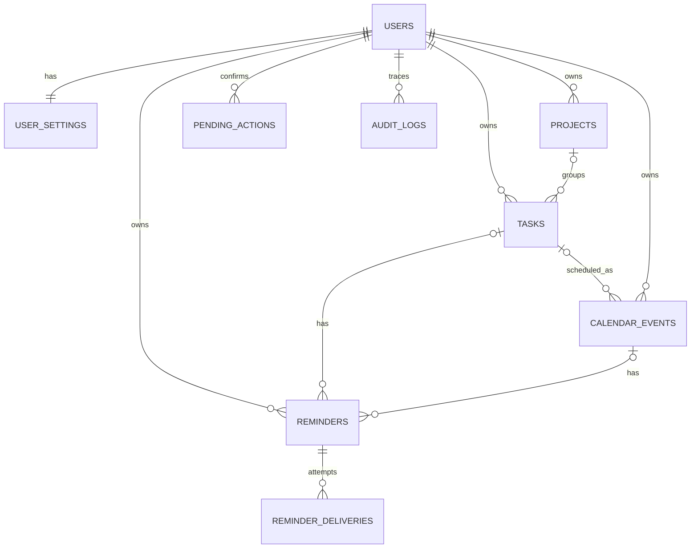

# Database Design — NOVA

**Mục tiêu:** Hệ thống CRUD bền vững, chuẩn bị sẵn cho AI Agent và scheduler. **Phase 0 chỉ thiết kế schema, chưa tạo database/migration.**

## 1. Quy ước chung

- SQLite local development; PostgreSQL cho production khi cần. SQLAlchemy ORM + Alembic migrations.
- Khoá PK: `id` kiểu UUID/string (có thể dùng `uuid` do app tạo), ngoại trừ `users.discord_user_id` là `VARCHAR(24)` để không gặp sai số JSON; Discord snowflakes luôn được so sánh theo ID gốc.
- Tất cả bản ghi riêng tư phải chứa `owner_id` tham chiếu `users.discord_user_id` (nếu không có trong bảng phải đi qua quan hệ sở hữu được enforce).
- Các mốc thời gian cụ thể lưu UTC-aware ở application layer, cột TIMESTAMP chuẩn hóa UTC; chuyển sang `Asia/Ho_Chi_Minh` khi hiển thị.
- Field `created_at`, `updated_at` trừ các bảng ghi sự kiện chỉ-append. Dùng `version` số nguyên cho optimistic concurrency trên event/task nếu workflow xác nhận.
- Constraints và indexes bắt buộc theo mô tả. `ON DELETE CASCADE` chỉ cho quan hệ phụ thuộc đã xác định; xóa dữ liệu quan trọng thường dùng soft-delete/confirmation.
- `status` và `priority`: quản lý enum bằng code + check constraint/migration; thống nhất giá trị lowercase.

## 2. Các bảng lõi và khi triển khai

### `users` — P1

| Cột | Kiểu | Ghi chú |
|---|---|---|
| `discord_user_id` | VARCHAR(24) PK | Owner allowlist |
| `timezone` | VARCHAR(64) | `Asia/Ho_Chi_Minh` |
| `locale` | VARCHAR(10) | `vi-VN` |
| `created_at` | DATETIME UTC | Not null |

Một bản ghi owner duy nhất trong MVP. **Không cấp quyền chỉ dựa trên có record DB**: config allowlist vẫn phải kiểm tra.

### `user_settings` — P1–P2

| Cột | Kiểu | Ghi chú |
|---|---|---|
| `owner_id` | VARCHAR(24) PK/FK | users |
| `morning_briefing_time` | TIME | Ví dụ `07:00`, local |
| `daily_review_time` | TIME | Ví dụ `21:30`, local |
| `workday_start` / `workday_end` | TIME | Local, cho planner |
| `quiet_start` / `quiet_end` | TIME NULL | Quiet hours có thể qua ngày |
| `dm_notifications_enabled` | BOOLEAN | Default true |
| `fallback_channel_id` | VARCHAR(24) NULL | Chỉ kênh riêng |
| `dashboard_channel_id` | VARCHAR(24) NULL | Channel menu |
| `dashboard_message_id` | VARCHAR(24) NULL | Pinned dashboard |
| `updated_at` | DATETIME UTC | Not null |

### `projects` — P3

| Cột | Kiểu | Ghi chú |
|---|---|---|
| `id` | UUID/string PK | Dự án |
| `owner_id` | VARCHAR(24) FK | Owner |
| `name` | VARCHAR(200) | Not null |
| `description` | TEXT NULL | |
| `status` | VARCHAR(20) | `active|paused|completed|archived` |
| `deadline_at` | DATETIME UTC NULL | |
| `created_at`, `updated_at` | DATETIME UTC | |

Index `(owner_id, status)`.

### `tasks` — P3

| Cột | Kiểu | Ghi chú |
|---|---|---|
| `id` | UUID/string PK | |
| `owner_id` | VARCHAR(24) FK | |
| `project_id` | UUID/string FK NULL | Chỉ được liên kết project cùng owner |
| `title` | VARCHAR(250) | Not null |
| `description` | TEXT NULL | |
| `status` | VARCHAR(20) | `todo|doing|done|cancelled` |
| `priority` | VARCHAR(20) | `low|medium|high|critical` |
| `estimated_minutes` | INTEGER NULL | >0 nếu có |
| `due_at` | DATETIME UTC NULL | |
| `completed_at` | DATETIME UTC NULL | |
| `version` | INTEGER | Default 1 |
| `created_at`, `updated_at` | DATETIME UTC | |

Indexes `(owner_id, status, due_at)`, `(project_id, status)`; validate project ownership. Task đã hoàn thành không có nghĩa event tự biến mất (phải quyết định trong service).

### `calendar_events` — P3

| Cột | Kiểu | Ghi chú |
|---|---|---|
| `id` | UUID/string PK | |
| `owner_id` | VARCHAR(24) FK | |
| `task_id` | UUID/string FK NULL | Nếu là time block cho task |
| `title` | VARCHAR(250) | |
| `starts_at`, `ends_at` | DATETIME UTC | `ends_at > starts_at` |
| `status` | VARCHAR(20) | `proposed|confirmed|cancelled` |
| `is_fixed` | BOOLEAN | Không tự đổi khi lập lịch |
| `origin` | VARCHAR(20) | `manual|agent|integration` |
| `version` | INTEGER | Optimistic concurrency |
| `created_at`, `updated_at` | DATETIME UTC | |

Index `(owner_id, starts_at, ends_at)`; check `ends_at > starts_at`; event link task phải thuộc cùng owner. Conflict là nghiệp vụ: events `confirmed` overlap phải được hiển thị/duyệt, không cấm DB tuyệt đối nếu chủ ý giữ lịch trùng.

### `reminders` — P4

| Cột | Kiểu | Ghi chú |
|---|---|---|
| `id` | UUID/string PK | |
| `owner_id` | VARCHAR(24) FK | |
| `task_id` | UUID/string FK NULL | Target task |
| `event_id` | UUID/string FK NULL | Target event |
| `title` | VARCHAR(250) | |
| `next_fire_at` | DATETIME UTC | Lần thông báo sắp tới |
| `recurrence_type` | VARCHAR(20) | `none|daily|weekly` (MVP) |
| `recurrence_config_json` | JSON/TEXT NULL | Theo ngày giờ local; validation |
| `delivery_target` | VARCHAR(20) | `dm|channel` |
| `channel_id` | VARCHAR(24) NULL | Kênh riêng nếu `channel` |
| `status` | VARCHAR(20) | `active|paused|done|cancelled` |
| `created_at`, `updated_at` | DATETIME UTC | |

Index `(status, next_fire_at)`; nếu gắn event, dời event confirmed sẽ cập nhật nhắc tương đối phù hợp.

### `reminder_deliveries` — P4

| Cột | Kiểu | Ghi chú |
|---|---|---|
| `id` | UUID/string PK | |
| `reminder_id` | UUID/string FK | |
| `scheduled_fire_at` | DATETIME UTC | Lần nhắc dự kiến |
| `status` | VARCHAR(20) | `pending|claimed|sent|failed` |
| `attempt_count` | INTEGER | Default 0 |
| `last_error_code` | VARCHAR(100) NULL | Không lưu secret/PII |
| `discord_message_id` | VARCHAR(24) NULL | Nếu gửi thành công |
| `claimed_at`, `sent_at` | DATETIME UTC NULL | |

UNIQUE `(reminder_id, scheduled_fire_at)`; index `(status, scheduled_fire_at)`. Dùng để retry, không thể cam kết exactly-once khi Discord API/send và commit DB không atomic.

### `pending_actions` — P5

| Cột | Kiểu | Ghi chú |
|---|---|---|
| `id` | UUID/string PK | Không dùng ID tuần tự dễ đoán |
| `owner_id` | VARCHAR(24) FK | |
| `action_type` | VARCHAR(80) | `reschedule_event|bulk_update|delete_...` |
| `payload_json` | JSON/TEXT | Validate theo schema; tránh lưu secret |
| `status` | VARCHAR(20) | `pending|approved|rejected|expired|executed` |
| `expires_at` | DATETIME UTC | Ngắn hạn, ví dụ 15 phút |
| `idempotency_key` | VARCHAR(128) UNIQUE | Không execute lặp |
| `created_at`, `updated_at` | DATETIME UTC | |

Phải lưu `expected_version` đối tượng để tránh duyệt hành động stale.

### `audit_logs` — P1 skeleton, đầy đủ P5

| Cột | Kiểu | Ghi chú |
|---|---|---|
| `id` | UUID/string PK | |
| `owner_id` | VARCHAR(24) FK NULL | Có thể là system nếu không có user |
| `actor` | VARCHAR(30) | `owner|agent|system` |
| `action` | VARCHAR(120) | `task.create`, `event.approve`, ... |
| `entity_type`, `entity_id` | VARCHAR(80), VARCHAR(64) | |
| `result` | VARCHAR(20) | `success|denied|error` |
| `safe_metadata_json` | JSON/TEXT NULL | Không raw secrets/messages |
| `created_at` | DATETIME UTC | |

Index `(owner_id, created_at)`.

## 3. Bảng về sau (không tạo bắt buộc ở P1)

| Bảng | Phase | Ghi chú |
|---|---|---|
| `conversation_messages` | P5 | Context giới hạn số lượng, retention opt-in |
| `memory_entries` | P6 | Fact/preference có nguồn gốc, đã xác nhận hay chỉ gợi ý |
| `automation_runs` | P6 | Theo dõi daily/weekly jobs, chống gửi lại cùng ngày |
| `goals` | P7 | Objective/deadline/status |
| `habit_definitions`, `habit_logs` | P7 | Thói quen và check-ins |
| `finance_transactions`, `budgets` | P7 | Ghi thu chi thủ công, **không đồng bộ ngân hàng tự động** |
| `notes` | P7 | Ghi chú có search |
| `integration_connections` | P7+ | Chỉ metadata; token phải encrypted/secret store |

## 4. Sơ đồ quan hệ rút gọn

## 5. Cần bảo đảm trong code

1. Query luôn `WHERE owner_id = current_owner_id`; không dùng ID từ LLM để bypass owner.
2. `task.project_id`, `calendar_event.task_id`, `reminder.*_id`: kiểm tra cùng owner tại service.
3. Không xóa hard dữ liệu có liên kết/ lịch quan trọng mà không xác nhận. Thiết kế soft-delete khi cần khôi phục.
4. Unique job/delivery keys cho retry; tránh tạo trùng khi nút bị bấm 2 lần.
5. Schema migratable: dùng Alembic; có test migration từ database rỗng.
6. SQLite bật `PRAGMA foreign_keys=ON`, DB transaction không bị chia lẻ nửa cập nhật.
7. Xóa memory/conversation phải có khả năng xóa dữ liệu liên quan theo policy; backup retention và quyền riêng tư ghi rõ.

## 6. Ví dụ nghiệp vụ tính tiến độ dự án

`project_progress = done_tasks / all_non_cancelled_tasks * 100%`, không có task trả `0%` và nhãn “Chưa có nhiệm vụ”. Đây là tỷ lệ theo **số lượng** chứ không phản ánh trọng số hay thời gian. Luôn nêu rõ cách tính trong báo cáo.

## 7. Hiện thực Phase 3A

- Revision `0002_core_management` nối tiếp `0001_foundation`, chỉ thêm `projects`, `tasks`, `calendar_events`; không rebuild/xóa bảng Foundation.
- IDs do app sinh UUID dạng string. FK trực tiếp `owner_id → users.discord_user_id` trên cả ba bảng. UNIQUE `(id, owner_id)` ở projects/tasks làm đích FK ghép `tasks(project_id, owner_id) → projects(id, owner_id)` và `calendar_events(task_id, owner_id) → tasks(id, owner_id)`. Các liên kết tùy chọn vẫn cho phép NULL.
- Tất cả quan hệ mới `ON DELETE RESTRICT`, không cascade hoặc tự gỡ liên kết khi xóa ORM. Relationship chỉ đồng bộ cột link, không tự đổi `owner_id`; truy vấn quan hệ xét cả owner. Async loading dùng `selectinload` rõ ràng.
- CHECK cho enum lowercase, tên/title không rỗng và giới hạn 200/250 ký tự, thời lượng nguyên dương nếu có, version nguyên dương, end > start và boolean `is_fixed`. ORM cũng validate tên, enum, thời lượng, version và boolean; `UTCDateTime` từ P1 từ chối datetime thiếu timezone, lưu UTC và khôi phục UTC-aware khi đọc SQLite.
- Indexes theo thiết kế ở mục 2; thêm `(task_id, owner_id)` trên calendar_events để hỗ trợ FK và tra cứu các block của một task.
- Defaults: project `active`; task `todo`, priority `medium`; event `proposed`, origin `manual`, `is_fixed=false`; version `1`. Created/updated do ORM cấp UTC, không nhận thời gian local ngầm định. SQL trực tiếp phải cấp timestamps UTC đã chuẩn hóa.
- `version_id_col` trên Task/CalendarEvent tăng version và chặn stale update/delete khi ORM flush; bulk SQL không tự có bảo vệ này. Quy tắc `completed_at`, overlap, confirmation và owner-scoped CRUD được làm ở 3B/3C, chưa có trong 3A. Enum có `agent`/`integration` theo schema, không kích hoạt tính năng đó.
- Downgrade từ 0002 về 0001 chỉ cho phép khi ba bảng mới rỗng; từ chối offline downgrade vì không kiểm tra được dữ liệu. Không có `drop_all()` hoặc reset DB.

Kết quả tests, database thực tế, migration và restore: [`PHASE_3A_VALIDATION.md`](PHASE_3A_VALIDATION.md).

Tham chiếu kỹ thuật: [SQLite composite foreign keys](https://www.sqlite.org/foreignkeys.html#fk_composite), [SQLAlchemy overlapping foreign keys](https://docs.sqlalchemy.org/en/21/orm/join_conditions.html#overlapping-foreign-keys), [ORM version counter](https://docs.sqlalchemy.org/en/21/orm/versioning.html), [Python SQLite backup API](https://docs.python.org/3.12/library/sqlite3.html#sqlite3.Connection.backup).
