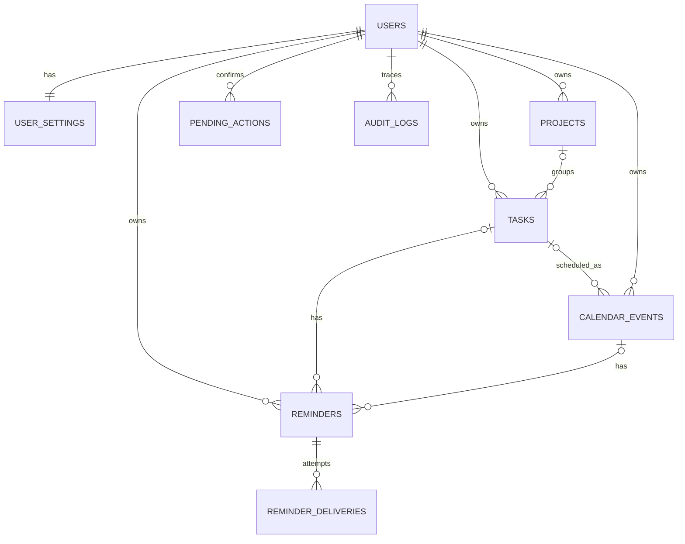

# Database Design — NOVA

## Quyết định triển khai P5 (2026-11-18)

Migration `0005_agent` chỉ thêm `pending_actions` và `agent_usage`; không thay bảng P1–P4.
Pending actions có owner FK, unique `(owner_id,idempotency_key)`, action/payload snapshot,
receipt, channel/message binding, UTC expiry/created/updated và trạng thái
`pending|rejected|expired|executed`. Duyệt và thực thi cùng transaction nên không lưu
trạng thái approved trung gian. Payload chỉ lưu dữ liệu cần review, không raw chat.
`agent_usage` ghi model, UTC timestamp, input/output tokens, charged/reserved tokens,
settled; reservation chưa biết kết quả được giữ bảo thủ qua restart. Không tạo bảng
conversation_messages; context RAM tối đa 20 messages/30 phút, có nút xóa.

Giải quyết khác biệt mô tả reminder tương đối trong thiết kế ban đầu: P4 lưu giờ tuyệt đối.
P5 không tự suy ra offset. Preview reschedule liệt kê reminder active/paused liên kết;
owner chọn **giữ giờ nhắc** hoặc **dời cùng độ lệch bắt đầu event**. Shift cập nhật cả rule
daily/weekly local, supersede delivery chưa gửi, giữ lịch sử đã gửi. Có claim đang hoạt động
thì từ chối; dùng chung lock với worker. Toàn bộ bulk, reminders, audit và executed receipt
commit nguyên tử, kiểm tra lại snapshots/versions/conflicts và timezone lúc duyệt.
Các mô tả schema phía dưới là thiết kế lịch sử; quyết định này là contract P5 thực thi.

**Mục tiêu:** Hệ thống CRUD bền vững, chuẩn bị sẵn cho AI Agent và scheduler. **Phase 0 chỉ thiết kế schema, chưa tạo database/migration.**

## 1. Quy ước chung

- SQLite local development; PostgreSQL cho production khi cần. SQLAlchemy ORM + Alembic migrations.
- Khoá PK: `id` kiểu UUID/string (có thể dùng `uuid` do app tạo), ngoại trừ `users.discord_user_id` là `VARCHAR(24)` để không gặp sai số JSON; Discord snowflakes luôn được so sánh theo ID gốc.
- Tất cả bản ghi riêng tư phải chứa `owner_id` tham chiếu `users.discord_user_id` (nếu không có trong bảng phải đi qua quan hệ sở hữu được enforce).
- Các mốc thời gian cụ thể lưu UTC-aware ở application layer, cột TIMESTAMP chuẩn hóa UTC; chuyển sang `Asia/Ho_Chi_Minh` khi hiển thị.
- Field `created_at`, `updated_at` trừ các bảng ghi sự kiện chỉ-append. Dùng `version` số nguyên cho optimistic concurrency trên event/task nếu workflow xác nhận.
- Constraints và indexes bắt buộc theo mô tả. `ON DELETE CASCADE` chỉ cho quan hệ phụ thuộc đã xác định; xóa dữ liệu quan trọng thường dùng soft-delete/confirmation.
- `status` và `priority`: quản lý enum bằng code + check constraint/migration; thống nhất giá trị lowercase.

## 2. Các bảng lõi và khi triển khai

### `users` — P1

| Cột | Kiểu | Ghi chú |
|---|---|---|
| `discord_user_id` | VARCHAR(24) PK | Owner allowlist |
| `timezone` | VARCHAR(64) | `Asia/Ho_Chi_Minh` |
| `locale` | VARCHAR(10) | `vi-VN` |
| `created_at` | DATETIME UTC | Not null |

Một bản ghi owner duy nhất trong MVP. **Không cấp quyền chỉ dựa trên có record DB**: config allowlist vẫn phải kiểm tra.

### `user_settings` — P1–P2

| Cột | Kiểu | Ghi chú |
|---|---|---|
| `owner_id` | VARCHAR(24) PK/FK | users |
| `morning_briefing_time` | TIME | Ví dụ `07:00`, local |
| `daily_review_time` | TIME | Ví dụ `21:30`, local |
| `workday_start` / `workday_end` | TIME | Local, cho planner |
| `quiet_start` / `quiet_end` | TIME NULL | Quiet hours có thể qua ngày |
| `dm_notifications_enabled` | BOOLEAN | Default true |
| `fallback_channel_id` | VARCHAR(24) NULL | Chỉ kênh riêng |
| `dashboard_channel_id` | VARCHAR(24) NULL | Channel menu |
| `dashboard_message_id` | VARCHAR(24) NULL | Pinned dashboard |
| `updated_at` | DATETIME UTC | Not null |

### `projects` — P3

| Cột | Kiểu | Ghi chú |
|---|---|---|
| `id` | UUID/string PK | Dự án |
| `owner_id` | VARCHAR(24) FK | Owner |
| `name` | VARCHAR(200) | Not null |
| `description` | TEXT NULL | |
| `status` | VARCHAR(20) | `active|paused|completed|archived` |
| `deadline_at` | DATETIME UTC NULL | |
| `created_at`, `updated_at` | DATETIME UTC | |

Index `(owner_id, status)`.

### `tasks` — P3

| Cột | Kiểu | Ghi chú |
|---|---|---|
| `id` | UUID/string PK | |
| `owner_id` | VARCHAR(24) FK | |
| `project_id` | UUID/string FK NULL | Chỉ được liên kết project cùng owner |
| `title` | VARCHAR(250) | Not null |
| `description` | TEXT NULL | |
| `status` | VARCHAR(20) | `todo|doing|done|cancelled` |
| `priority` | VARCHAR(20) | `low|medium|high|critical` |
| `estimated_minutes` | INTEGER NULL | >0 nếu có |
| `due_at` | DATETIME UTC NULL | |
| `completed_at` | DATETIME UTC NULL | |
| `version` | INTEGER | Default 1 |
| `created_at`, `updated_at` | DATETIME UTC | |

Indexes `(owner_id, status, due_at)`, `(project_id, status)`; validate project ownership. Task đã hoàn thành không có nghĩa event tự biến mất (phải quyết định trong service).

### `calendar_events` — P3

| Cột | Kiểu | Ghi chú |
|---|---|---|
| `id` | UUID/string PK | |
| `owner_id` | VARCHAR(24) FK | |
| `task_id` | UUID/string FK NULL | Nếu là time block cho task |
| `title` | VARCHAR(250) | |
| `starts_at`, `ends_at` | DATETIME UTC | `ends_at > starts_at` |
| `status` | VARCHAR(20) | `proposed|confirmed|cancelled` |
| `is_fixed` | BOOLEAN | Không tự đổi khi lập lịch |
| `origin` | VARCHAR(20) | `manual|agent|integration` |
| `version` | INTEGER | Optimistic concurrency |
| `created_at`, `updated_at` | DATETIME UTC | |

Index `(owner_id, starts_at, ends_at)`; check `ends_at > starts_at`; event link task phải thuộc cùng owner. Conflict là nghiệp vụ: events `confirmed` overlap phải được hiển thị/duyệt, không cấm DB tuyệt đối nếu chủ ý giữ lịch trùng.

### `reminders` — P4

| Cột | Kiểu | Ghi chú |
|---|---|---|
| `id` | UUID/string PK | |
| `owner_id` | VARCHAR(24) FK | |
| `task_id` | UUID/string FK NULL | Target task |
| `event_id` | UUID/string FK NULL | Target event |
| `title` | VARCHAR(250) | |
| `next_fire_at` | DATETIME UTC | Lần thông báo sắp tới |
| `recurrence_type` | VARCHAR(20) | `none|daily|weekly` (MVP) |
| `recurrence_config_json` | JSON/TEXT NULL | Theo ngày giờ local; validation |
| `delivery_target` | VARCHAR(20) | `dm|channel` |
| `channel_id` | VARCHAR(24) NULL | Kênh riêng nếu `channel` |
| `status` | VARCHAR(20) | `active|paused|done|cancelled` |
| `created_at`, `updated_at` | DATETIME UTC | |

Index `(status, next_fire_at)`; nếu gắn event, dời event confirmed sẽ cập nhật nhắc tương đối phù hợp.

### `reminder_deliveries` — P4

| Cột | Kiểu | Ghi chú |
|---|---|---|
| `id` | UUID/string PK | |
| `reminder_id` | UUID/string FK | |
| `scheduled_fire_at` | DATETIME UTC | Lần nhắc dự kiến |
| `status` | VARCHAR(20) | `pending|claimed|sent|failed` |
| `attempt_count` | INTEGER | Default 0 |
| `last_error_code` | VARCHAR(100) NULL | Không lưu secret/PII |
| `discord_message_id` | VARCHAR(24) NULL | Nếu gửi thành công |
| `claimed_at`, `sent_at` | DATETIME UTC NULL | |

UNIQUE `(reminder_id, scheduled_fire_at)`; index `(status, scheduled_fire_at)`. Dùng để retry, không thể cam kết exactly-once khi Discord API/send và commit DB không atomic.

### `pending_actions` — P5

| Cột | Kiểu | Ghi chú |
|---|---|---|
| `id` | UUID/string PK | Không dùng ID tuần tự dễ đoán |
| `owner_id` | VARCHAR(24) FK | |
| `action_type` | VARCHAR(80) | `reschedule_event|bulk_update|delete_...` |
| `payload_json` | JSON/TEXT | Validate theo schema; tránh lưu secret |
| `status` | VARCHAR(20) | `pending|approved|rejected|expired|executed` |
| `expires_at` | DATETIME UTC | Ngắn hạn, ví dụ 15 phút |
| `idempotency_key` | VARCHAR(128) UNIQUE | Không execute lặp |
| `created_at`, `updated_at` | DATETIME UTC | |

Phải lưu `expected_version` đối tượng để tránh duyệt hành động stale.

### `audit_logs` — P1 skeleton, đầy đủ P5

| Cột | Kiểu | Ghi chú |
|---|---|---|
| `id` | UUID/string PK | |
| `owner_id` | VARCHAR(24) FK NULL | Có thể là system nếu không có user |
| `actor` | VARCHAR(30) | `owner|agent|system` |
| `action` | VARCHAR(120) | `task.create`, `event.approve`, ... |
| `entity_type`, `entity_id` | VARCHAR(80), VARCHAR(64) | |
| `result` | VARCHAR(20) | `success|denied|error` |
| `safe_metadata_json` | JSON/TEXT NULL | Không raw secrets/messages |
| `created_at` | DATETIME UTC | |

Index `(owner_id, created_at)`.

## 3. Bảng về sau (không tạo bắt buộc ở P1)

| Bảng | Phase | Ghi chú |
|---|---|---|
| `conversation_messages` | P5 | Context giới hạn số lượng, retention opt-in |
| `memory_entries` | P6 | Memory có nguồn, chỉ lưu sau owner duyệt; gợi ý nằm ở pending_actions |
| `automation_policies` | P6 | Cấu hình giờ làm và ba lịch báo cáo opt-in, có version |
| `automation_runs` | P6 | Theo dõi daily/weekly jobs, chống gửi lại cùng kỳ |
| `goals` | P7 | Objective/deadline/status |
| `habit_definitions`, `habit_logs` | P7 | Thói quen và check-ins |
| `finance_transactions`, `budgets` | P7 | Ghi thu chi thủ công, **không đồng bộ ngân hàng tự động** |
| `notes` | P7 | Ghi chú có search |
| `integration_connections` | P7+ | Chỉ metadata; token phải encrypted/secret store |

## 4. Sơ đồ quan hệ rút gọn

## 5. Cần bảo đảm trong code

1. Query luôn `WHERE owner_id = current_owner_id`; không dùng ID từ LLM để bypass owner.
2. `task.project_id`, `calendar_event.task_id`, `reminder.*_id`: kiểm tra cùng owner tại service.
3. Không xóa hard dữ liệu có liên kết/ lịch quan trọng mà không xác nhận. Thiết kế soft-delete khi cần khôi phục.
4. Unique job/delivery keys cho retry; tránh tạo trùng khi nút bị bấm 2 lần.
5. Schema migratable: dùng Alembic; có test migration từ database rỗng.
6. SQLite bật `PRAGMA foreign_keys=ON`, DB transaction không bị chia lẻ nửa cập nhật.
7. Xóa memory/conversation phải có khả năng xóa dữ liệu liên quan theo policy; backup retention và quyền riêng tư ghi rõ.

## 6. Ví dụ nghiệp vụ tính tiến độ dự án

`project_progress = done_tasks / all_non_cancelled_tasks * 100%`, không có task trả `0%` và nhãn “Chưa có nhiệm vụ”. Đây là tỷ lệ theo **số lượng** chứ không phản ánh trọng số hay thời gian. Luôn nêu rõ cách tính trong báo cáo.

## 7. Hiện thực Phase 3A

- Revision `0002_core_management` nối tiếp `0001_foundation`, chỉ thêm `projects`, `tasks`, `calendar_events`; không rebuild/xóa bảng Foundation.
- IDs do app sinh UUID dạng string. FK trực tiếp `owner_id → users.discord_user_id` trên cả ba bảng. UNIQUE `(id, owner_id)` ở projects/tasks làm đích FK ghép `tasks(project_id, owner_id) → projects(id, owner_id)` và `calendar_events(task_id, owner_id) → tasks(id, owner_id)`. Các liên kết tùy chọn vẫn cho phép NULL.
- Tất cả quan hệ mới `ON DELETE RESTRICT`, không cascade hoặc tự gỡ liên kết khi xóa ORM. Relationship chỉ đồng bộ cột link, không tự đổi `owner_id`; truy vấn quan hệ xét cả owner. Async loading dùng `selectinload` rõ ràng.
- CHECK cho enum lowercase, tên/title không rỗng và giới hạn 200/250 ký tự, thời lượng nguyên dương nếu có, version nguyên dương, end > start và boolean `is_fixed`. ORM cũng validate tên, enum, thời lượng, version và boolean; `UTCDateTime` từ P1 từ chối datetime thiếu timezone, lưu UTC và khôi phục UTC-aware khi đọc SQLite.
- Indexes theo thiết kế ở mục 2; thêm `(task_id, owner_id)` trên calendar_events để hỗ trợ FK và tra cứu các block của một task.
- Defaults: project `active`; task `todo`, priority `medium`; event `proposed`, origin `manual`, `is_fixed=false`; version `1`. Created/updated do ORM cấp UTC, không nhận thời gian local ngầm định. SQL trực tiếp phải cấp timestamps UTC đã chuẩn hóa.
- `version_id_col` trên Task/CalendarEvent tăng version và chặn stale update/delete khi ORM flush; bulk SQL không tự có bảo vệ này. Quy tắc `completed_at`, overlap, confirmation và owner-scoped CRUD được làm ở 3B/3C, chưa có trong 3A. Enum có `agent`/`integration` theo schema, không kích hoạt tính năng đó.
- Downgrade từ 0002 về 0001 chỉ cho phép khi ba bảng mới rỗng; từ chối offline downgrade vì không kiểm tra được dữ liệu. Không có `drop_all()` hoặc reset DB.

Kết quả tests, database thực tế, migration và restore: [`PHASE_3A_VALIDATION.md`](PHASE_3A_VALIDATION.md).

Tham chiếu kỹ thuật: [SQLite composite foreign keys](https://www.sqlite.org/foreignkeys.html#fk_composite), [SQLAlchemy overlapping foreign keys](https://docs.sqlalchemy.org/en/21/orm/join_conditions.html#overlapping-foreign-keys), [ORM version counter](https://docs.sqlalchemy.org/en/21/orm/versioning.html), [Python SQLite backup API](https://docs.python.org/3.12/library/sqlite3.html#sqlite3.Connection.backup).

## 8. Services Phase 3B

Schema/revision giữ nguyên `0002_core_management`. Repositories mới luôn áp dụng owner predicate khi đọc/đếm/update; không cho update ID/owner/version/origin từ payload. Service xác thực config owner trước mở transaction, kiểm tra liên kết trong scope và trả immutable DTO sau commit. UPDATE so sánh version task/event hoặc updated_at project trong cùng WHERE, đồng thời tăng version/cập nhật timestamp.

Ghi qua services dùng tùy chọn BEGIN IMMEDIATE trước query để serialize SQLite read-check-write và kiểm tra overlap; engine mặc định của Foundation/migration không đổi. Creation chống lặp bằng UUID5 từ owner + loại entity + request_id, không thêm cột hoặc migration. Retry cùng key/payload trả record hiện có; payload đã khác thì từ chối, không tạo thêm.

CRUD dùng archive/cancel thay hard-delete. Hoàn thành/mở lại task đặt/xóa completed_at, không tự đổi event liên kết. Calendar overlap chỉ xét confirmed, dùng `new_start < end AND new_end > start`, không tính event đang sửa; vẫn cho giữ lịch trùng sau xác nhận ràng buộc dữ liệu. Pending actions thủ công 3B nằm trong bộ nhớ, không phải bảng pending_actions P5; mất sau restart. Xem giao thức và giới hạn trong [`PHASE_3B_VALIDATION.md`](PHASE_3B_VALIDATION.md).

## 9. Query cho UI Phase 3C

Không đổi schema/revision. DashboardRepository + SummaryService cung cấp aggregate theo owner trong read transaction: Tasks không cancelled, done trong tập này, Projects không archived và confirmed events giao khoảng ngày local. Không tạo bảng Reminders hoặc dùng số 0 cho module chưa triển khai. Today task query chỉ xét todo/doing, lọc deadline trước cuối ngày (bao gồm overdue) hoặc priority high/critical, trả tối đa 5 previews và tổng thật.

UI chỉ gọi services, không chạy SQL. Home và dữ liệu record trả ephemeral; bảng neo chỉ điều hướng. CoreServices sống suốt client lifecycle để giữ pending actions giữa submit và approve; không restore pending approvals khi restart. UI giữ nguyên DTO field không sửa, expected version/updated_at và request_id khi retry. `CalendarService.list_day/list_week` nhận thêm status filter, tương thích API 3B. Tests/runbook tại [`PHASE_3C_VALIDATION.md`](PHASE_3C_VALIDATION.md).

## 10. Hiện thực Phase 4A

Revision `0003_reminders` nối tiếp `0002_core_management`. Chỉ tạo reminders/deliveries và unique index `(id, owner_id)` trên calendar_events, không rebuild bảng/cập nhật dữ liệu P1–3. Mục này mô tả checkpoint 4A (head khi đó là 0003); head hiện tại ở mục 11. DB vận hành chưa có trên máy triển khai nên chưa migrate thật.

- `Reminder` theo schema ở mục 2, owner FK RESTRICT, FK ghép task/owner và event/owner. Indexes `(status, next_fire_at)`, `(owner_id, status)` và các cặp link/owner. Optional links có thể NULL, gán relationship không tự đổi owner.
- `ReminderDelivery` theo mục 2; owner qua reminder cha. UNIQUE `(reminder_id, scheduled_fire_at)` và index `(status, scheduled_fire_at)`. Tất cả FK mới RESTRICT, không hard-delete/cascade lịch sử.
- Mở rộng snooze bằng `delivery_kind=scheduled|snooze`, `parent_delivery_id`. FK ghép parent/reminder yêu cầu cùng reminder, unique parent chặn hai snooze từ một delivery, cấm tự làm parent. Có thể hoãn tiếp từ delivery snooze. Đây là schema, chưa có service/worker hoặc notification buttons.
- ORM dùng UTCDateTime cho tất cả timestamps reminder/delivery. Recurrence JSON dùng SQL NULL khi không lặp; daily/weekly chứa `time` HH:MM, `timezone` IANA, weekly có thêm `weekday` 0–6. SQL CHECK bảo vệ enum/presence/target/count; domain và mapper kiểm tra JSON/timezone, tương quan weekday/loại lặp và lần gửi đầu.
- `ReminderData`/`RecurrenceRule` là immutable; create service sau này phải gọi validate_create với backend clock, từ chối quá khứ/hiện tại. Đọc/lưu lịch sử vẫn hợp lệ. Chưa tính next occurrence hoặc đổi lịch gắn event; liên kết hiện dùng mốc tuyệt đối, không offset.
- `last_error_code` allowlist `forbidden|http_error|network_error|timeout|unknown_error`; không nhận raw exception text. Private channel permission/allowlist và authorization actor cần service 4B; schema chỉ validate ID và quan hệ.
- Downgrade 0003 → 0002 chỉ cho phép khi cả hai bảng P4 rỗng; offline downgrade bị từ chối. Không xóa dữ liệu để rollback. Backup/upgrade/restore và rollback khi ngắt migration đã có tests bảo toàn mọi cột P1–3.

Kết quả lịch sử **551 tests pass** và schema 4A: [`PHASE_4A_VALIDATION.md`](PHASE_4A_VALIDATION.md). 4B/4C hiện thực ở mục 11; chưa có pending_actions P5.

## 11. Hiện thực Phase 4B/4C

Head **`0004_reminder_dispatch`** chỉ thêm cột nullable vào reminder_deliveries, giữ toàn bộ dữ liệu 4A:

| Cột | Ý nghĩa |
|---|---|
| `retry_at` DATETIME UTC | Mốc retry, quiet delay hoặc lease expiry để phục hồi sau restart |
| `claim_token` VARCHAR(36) | UUID mỗi claim; completion phải khớp token và claimed status |
| `finished_reason` VARCHAR(20) NULL | Backend ghi `overdue|superseded|blocked|exhausted`; terminal không retry |
| `acknowledged_at` DATETIME UTC NULL | Đã xử lý Done/Snooze; chặn replay trên notification |

Không rebuild bảng hoặc sửa migration 0003. Downgrade 0004 → 0003 chỉ khi không có delivery history; offline downgrade bị từ chối. Tests xác minh old columns/rows giữ nguyên, metadata mới NULL và interruption rollback partial ADD COLUMN.

Repository luôn owner-scope, delivery join reminder. Service kiểm tra config owner trước DB, transaction BEGIN IMMEDIATE, UUID5 creation idempotency và expected updated_at cho mutation. Shared process lock serialize mutation/send; không giữ DB transaction khi gọi Discord. Sensitive changes có in-memory pending approval TTL 5 phút/payload binding, không có executor AI.

Worker tạo tối đa một row cho occurrence, claim trước gửi, retry capped và lease recovery; sent/message ID/next occurrence được ghi sau API success trong cùng transaction. Quiet/catch-up/recurrence/snooze policy tại [`PHASE_4BC_VALIDATION.md`](PHASE_4BC_VALIDATION.md). Discord send và SQLite commit không atomic; crash có thể làm gửi lại, không exactly-once. Snooze không thay rule/next_fire_at gốc, không tự dời reminder khi task/event sửa.

UI và DynamicItem notification chỉ gọi services, không SQL; DB counts của Home đếm reminders active. Settings dùng lại user_settings DM/fallback/quiet columns; không cần env/dependency mới. Source/tests **617 pass**, DB/Discord thật còn chờ nghiệm thu.

## 12. Persistence Phase 6

Revision `0006_personal` nối tiếp `0005_agent`, chỉ thêm ba bảng và cột
`agent_usage.purpose` non-null mặc định `dm`. Dữ liệu P1–5 không rebuild hoặc
backfill nghiệp vụ. Timestamps app dùng UTCDateTime; giờ HH:MM/weekday trong
policy là giờ local theo timezone Settings, không phải UTC timestamp.

| Bảng | Nội dung/ràng buộc chính |
|---|---|
| memory_entries | UUID PK, owner FK, content nullable (tombstone), kind preference/routine/profile; source backend; confirmed_by_owner, use_for_ai, is_deleted; version > 0; created/updated/last_used UTC |
| automation_policies | UUID PK, owner FK, kind preferences/morning/daily/weekly; unique(owner,kind); enabled false khi chưa duyệt; config_json đã validate, version > 0, updated_at |
| automation_runs | UUID PK, owner FK, kind/period_key/timezone, UTC scheduled/expires/claimed/retry/sent/created; policy_version; status pending/claimed/sent/failed/skipped; attempt_count >= 0; claim_token; payload/error/message/channel metadata; unique(owner,kind,period_key) |

Memory candidates nằm trong pending_actions. Bảng memory chỉ tạo khi owner
Duyệt. Xóa làm rỗng content/source/last_used_at, tăng version, giữ tombstone và
xóa các bản sao trong pending actions. Không purge audit metadata hoặc backup cũ.
Cột kind thay tên khái niệm type; xác nhận dựa trên owner, không dựa confidence AI.

Work policy lưu ngày làm/giờ làm/khoảng nghỉ/gợi ý memory; sau duyệt đồng bộ giờ
làm vào UserSettings cũ. Automation policy là nguồn chính cho giờ/bật/tắt báo
cáo P6; không ngầm bật dựa vào các cột briefing giờ P1. Chưa cấu hình trả mặc định
ảo và không ghi row, thuận tiện rollback trước khi dùng P6.

Run period là ngày local, weekly là ngày thứ Hai đầu tuần. Giữ khóa/metadata kể
cả khi payload bị purge sau 30 ngày. Không tạo lại kỳ đã sent/skipped/failed khi
owner đổi giờ hoặc restart. Lease 2 phút, 3 attempts, retry 1/5 phút, catch-up 2h;
quiet hours trì hoãn trong cửa sổ. Không cam kết exactly-once ở Discord.

Downgrade về 0005 chỉ khi ba bảng rỗng và không có agent_usage background. Có dữ
liệu thì từ chối; không tự delete để downgrade. Backup/restore/drill, tests và
phạm vi nghiệm thu ở [PHASE_6_VALIDATION](PHASE_6_VALIDATION.md).
